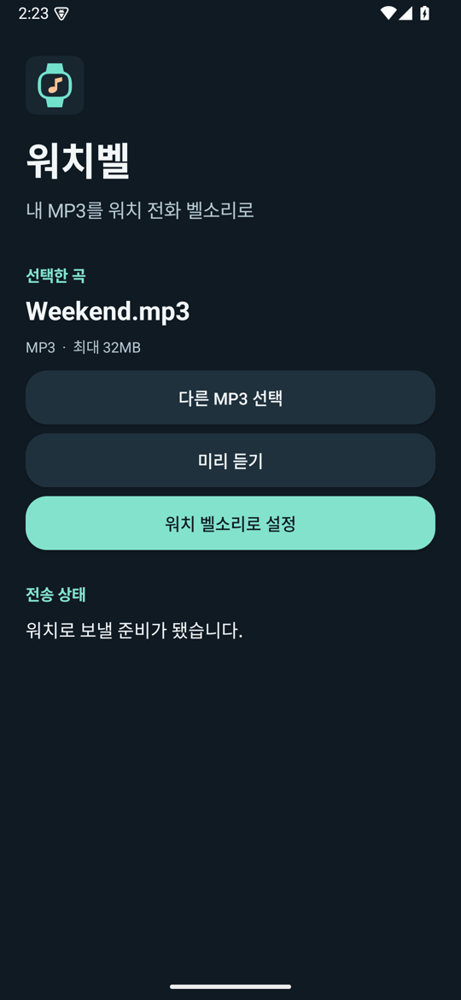
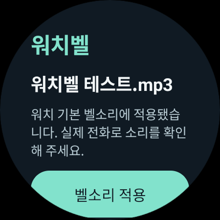
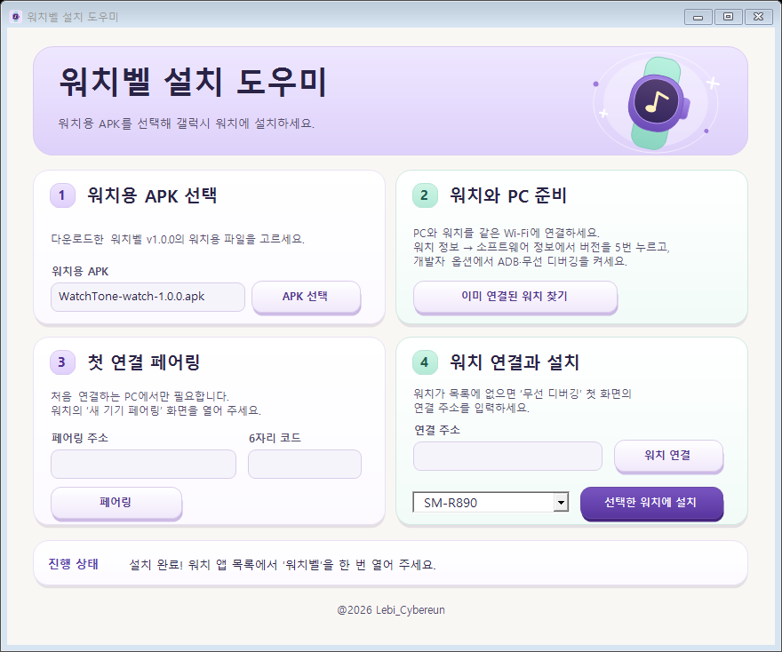

# 워치벨 · WatchTone

[](#개발자)

갤럭시 휴대폰의 MP3를 Wear OS 워치로 보내 기본 전화 벨소리로 지정합니다.

- [소개 영상과 설치 안내](https://cybereun.github.io/WatchTone/)
- [v1.0.0 다운로드](https://github.com/cybereun/WatchTone/releases/tag/v1.0.0)

휴대폰에는 휴대폰용 APK를, 워치에는 워치용 APK를 설치합니다. 앱은 같은 패키지 이름과 같은 인증서로 서명되어야 합니다. 갤럭시 S24 울트라와 갤럭시 워치4 클래식에서 MP3 전송과 워치 시스템 기본 벨소리 변경을 확인했습니다.

## 실제 실행 화면

<table>
  <tr>
    <th>휴대폰용 워치벨</th>
    <th>워치용 워치벨</th>
  </tr>
  <tr>
    <td></td>
    <td></td>
  </tr>
</table>

휴대폰용과 워치용 화면은 실제 APK를 각 에뮬레이터에서 실행해 캡처했습니다.

### Windows 설치 도우미



## 빌드

JDK, Android SDK 플랫폼 35, 빌드 도구 35.0.0이 필요합니다. Android SDK 경로를 지정하고 PowerShell에서 빌드합니다.

```powershell
.\build-apk.ps1 -SdkPath "C:\Android\Sdk"
```

다른 PC에서 새로 생성된 서명 키는 공식 배포 APK와 다릅니다. 두 기기에 같은 빌드의 APK를 설치하세요.

## 설치 후 사용

두 기기에서 앱을 한 번씩 열고 휴대폰에서 MP3를 고릅니다. **워치 벨소리로 설정**을 누르고, 워치에서 요청할 경우 **벨소리 적용**과 시스템 설정 변경 허용을 진행합니다. 워치를 소리 모드로 두고 다른 휴대폰에서 전화를 걸어 선택한 곡이 울리는지 확인할 수 있습니다.

## Windows 설치 도우미

[설치 도우미 EXE](https://github.com/cybereun/WatchTone/releases/download/v1.0.0/WatchTone-Windows-Installer-1.0.2.exe)에서 공식 v1.0.0 워치용 APK를 선택해 설치할 수 있습니다. 첫 연결 때 연결 도구를 Google에서 내려받습니다. 도우미 소스는 windows-installer 폴더에 있습니다.

## 개발자

**Lebi_Cybereun** · 워치벨과 Windows 설치 도우미 개발

## 저작권

**© 2026 Lebi_Cybereun. All rights reserved.**

워치벨과 Windows 설치 도우미는 MIT 라이선스로 제공되지 않습니다. 개발자의 사전 서면 허가 없이 프로젝트의 자체 소스 코드나 배포 파일을 수정하거나, 원본 또는 수정본을 재배포할 수 없습니다.
